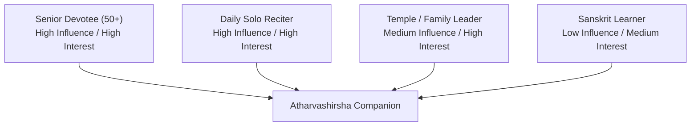
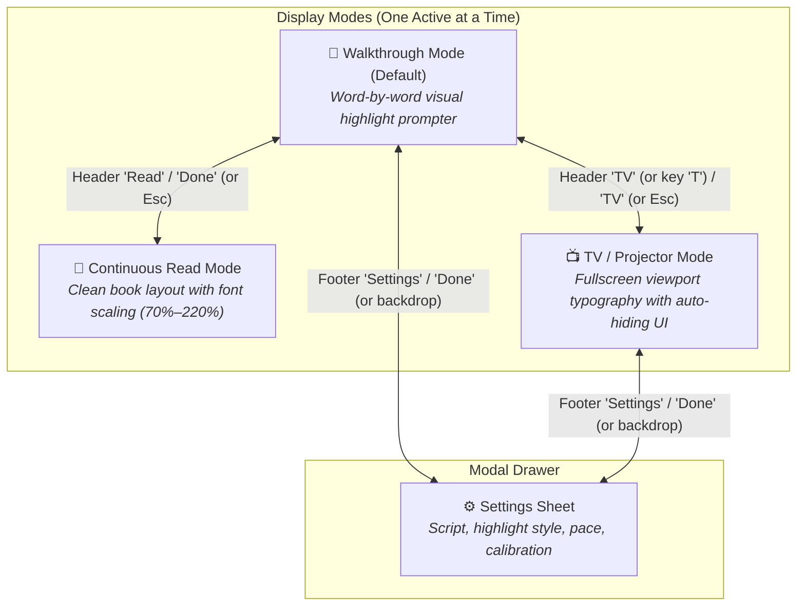

# Business Requirements Document (BRD)
## Atharvashirsha Recitation Walkthrough & Reading Companion

*Document Version:* 1.0.0 (Retrospective)  
*Framework:* IIBA BABOK Guide v3  
*Domain:* Vedic Chanting & Devotional Software (Bhajanjam)  
*Status:* Approved / Baselines Implemented  

---

## 1. Executive Summary

The **Atharvashirsha Recitation Walkthrough** is a standalone, client-side digital chanting companion and reader for the sacred Sanskrit hymn *Śrī Gaṇapati Atharvaśīrṣa*. It addresses the core frustrations of devotees during daily prayer and group worship: losing place during rapid recitation, visual eye strain from dense traditional book prints, awkward navigation on small touchscreens, and the lack of accessible multi-script support. The application provides three specialized viewing modes (Walkthrough, Continuous Read, and TV/Projector), an intelligent Sanskrit prosody-based pacing engine (`matras()`), elderly-friendly touch ergonomics, and complete offline independence without external audio streaming dependencies.

---

## 2. Business Objectives & Background

| ID | Objective | Baseline / Problem | Target Outcome |
| :--- | :--- | :--- | :--- |
| **BO-1** | **Eliminate Recitation Drift** | Traditional paper books or static PDFs provide no tracking; devotees lose their place during recitation. | Provide real-time visual guidance matching the natural metrical cadence of Sanskrit chanting. |
| **BO-2** | **Ergonomic Accessibility for 50+ Demographic** | Standard mobile apps use small (<40px) icons and cluttered toolbars that cause miss-taps for older users. | Enforce minimum 60–76px touch targets, high-contrast borders, and worded button labels. |
| **BO-3** | **Temple & Group Chanting Utility** | In communal worship, participants lack synchronized text visibility from a distance. | Deliver an auto-hiding fullscreen TV/Projector mode with keyboard navigation. |
| **BO-4** | **Vocal Autonomy without Audio Interference** | Audio-playing apps impose an external recorded pace that clashes with a reciter's breath and rhythm. | Keep the platform audio-free, serving as an adaptive visual prompter for self-recitation. |
| **BO-5** | **Zero-Friction Offline Distribution** | Complex web apps require servers, build steps, or internet connections unavailable in home pooja rooms. | 100% self-contained single-file HTML delivery runnable via `file://` or static GitHub Pages. |

---

## 3. Scope Boundary

### 3.1 In-Scope
- **Walkthrough Mode**: Sequential word-by-word and phrase-by-phrase visual highlighting with automated pacing.
- **Sanskrit Metrical Engine**: Calculation of syllable weights (*Laghu* = 1 beat, *Guru* = 2 beats) with breath pauses at *dandas* (`।` = 450 ms, `॥` = 1200 ms).
- **Continuous Read Mode**: Distraction-free, scalable (70%–220%) book-style text presentation with inline dimmed dandas.
- **TV / Projector Mode**: Viewport-scaled typography, hidden mouse cursor, and keyboard transport shortcuts (`Space`, `ArrowLeft`, `ArrowRight`, `R`, `F`, `Esc`).
- **Multi-Script Engine**: On-the-fly toggling between Devanagari (`देवनागरी`), Roman transliteration (IAST), and Bilingual stacked view.
- **Elderly-Friendly UI (50+ Focus)**: 60–76px control buttons, explicit word labels ("Read", "TV", "Start again"), bottom settings sheet.
- **State Persistence**: Automatic saving of speed, script, theme, style, font size, and custom calibration to `localStorage`.

### 3.2 Out-of-Scope (Explicitly Excluded)
- External audio playback or streaming mp3/m4a audio tracks.
- Cloud account management, user authentication, or social sharing.
- Server-side database storage or analytics tracking.
- Chanting audio recording and server uploads.

---

## 4. Stakeholder & Persona Analysis

| Persona | Role | Primary Needs | Friction Points Addressed |
| :--- | :--- | :--- | :--- |
| **Senior Devotee (50+)** | Primary User | Clear large typography, high-contrast borders, no small icons, uncluttered everyday controls. | Eliminates accidental miss-taps; eliminates need for reading glasses via large font modes. |
| **Daily Solo Reciter** | Primary User | Fluid rhythm prompter, instant jump on tap, seamless restart for repeated *avartans*. | Eliminates losing place; prominent "Start again" button replaces hunting for loop controls. |
| **Group / Temple Leader** | Secondary User | High-visibility presentation on living room TV or temple projector with hands-off display. | Provides TV mode with auto-hiding controls and wireless remote / keyboard operation. |
| **Sanskrit Learner** | Secondary User | Pronunciation clarity, Roman IAST transliteration, word-level stepping. | Bilingual stacked view displays IAST phonetics directly beneath Devanagari words. |

---

## 5. Functional Requirements (MoSCoW)

| ID | Requirement Statement | Priority | Owner | Acceptance Criterion | Traceability |
| :--- | :--- | :--- | :--- | :--- | :--- |
| **FR-01** | **Walkthrough Progression**: The system shall highlight words or phrases sequentially during recitation. | **Must** | Core Engine | Highlighting advances automatically when playing, or on Next/Prev clicks, applying distinct styles (`.now`, `.done`). | BO-1 |
| **FR-02** | **Sanskrit Metrical Prosody**: The system shall calculate word display duration based on Sanskrit *mātrā* rules. | **Must** | Prosody Engine | Short vowels = 1 beat, long vowels/conjuncts/anusvaras = 2 beats; pauses at `।` (450ms) and `॥` (1200ms). | BO-1, BO-4 |
| **FR-03** | **Continuous Read Mode**: The system shall provide a distraction-free static text view with independent text scaling. | **Must** | UI Layer | Toggling "Read" hides chrome, renders continuous text with centered verse numbers, and scales font from 70% to 220%. | BO-2 |
| **FR-04** | **TV / Projector Mode**: The system shall provide a fullscreen display mode with viewport-scaled typography and auto-hiding UI. | **Must** | UI Layer | Entering TV mode triggers fullscreen; footer auto-hides after 3.5s; responds to Space, Arrows, R, F, Esc. | BO-3 |
| **FR-05** | **Multi-Script Presentation**: The system shall support Devanagari, Roman (IAST), and Bilingual display. | **Must** | Corpus Layer | Switching script updates all active views immediately without losing recitation position. | BO-1, BO-2 |
| **FR-06** | **Elderly-Friendly Touch Ergonomics**: Primary transport controls shall measure between 60px and 76px with 2px borders. | **Must** | Design / UX | Play button = 76px, transport = 60px, header buttons = 48px with verbal labels ("Read", "TV", "Start again"). | BO-2 |
| **FR-07** | **Settings Bottom Sheet**: Secondary settings shall be housed in a modal bottom sheet. | **Must** | Design / UX | Script, Highlight Style, Step Unit, and Timing Calibration reside in `#sheet`, leaving everyday controls clean. | BO-2 |
| **FR-08** | **Interactive Jump-on-Tap**: Tapping any word or verse context shall immediately set the active recitation point. | **Must** | UI Layer | Tapping a word sets `v`, `p`, `w`; manual scrolling pauses auto-follow for 4 seconds. | BO-1, BO-2 |
| **FR-09** | **Day / Night Theming**: The system shall provide high-contrast light and dark themes. | **Should** | UI Layer | Respects OS `prefers-color-scheme` with manual toggle stored in `localStorage`. | BO-2 |
| **FR-10** | **Tap Calibration**: The system shall allow manual recording of per-word durations. | **Should** | Prosody Engine | Tapping "Next" in calibration mode records elapsed millisecond delta per word into `localStorage` (`as_calib`). | BO-1 |
| **FR-11** | **Avartan Repetition Counter**: The system shall track completed cycles of the hymn during repetitive practice. | **Could** | Roadmap | Increments an *Avartan* counter upon reaching the final verse and restarting. | BO-1, BO-4 |
| **FR-12** | **Audio Streaming Playback**: External recorded chanting audio stream. | **Won't** | Architecture | Deliberately excluded to maintain vocal autonomy and client-side portability. | BO-4, BO-5 |

---

## 6. Non-Functional Requirements (MoSCoW)

| ID | Category | Requirement Statement | Priority | Metric / Verification |
| :--- | :--- | :--- | :--- | :--- |
| **NFR-01** | **Architecture** | Single-file zero-dependency distribution. | **Must** | Entire application bundled in single `index.html` under 50 KB without build toolchains. |
| **NFR-02** | **Performance** | DOM updates and visual transitions must maintain 60 fps. | **Must** | In-place DOM class toggling (`.classList.toggle`) avoids rebuilding innerHTML during active verse chanting. |
| **NFR-03** | **Offline Capability** | Fully operational with zero internet connection once loaded. | **Must** | All hymn text, logic, and styles execute locally; fallback system fonts ensure zero font-load blocking. |
| **NFR-04** | **Usability** | 4-second scroll decoupling. | **Must** | Manual user touch/scroll events pause automated scroll centering for 4000 ms (`userScrollTs`). |
| **NFR-05** | **Platform Support** | Responsive compatibility from 320px mobile screens to 4K projector displays. | **Must** | Fluid CSS `clamp()` and viewport units (`vh`/`vw`) ensure correct scaling across all form factors. |
| **NFR-06** | **State Persistence** | User preferences persist across sessions. | **Must** | `as_speed`, `as_style`, `as_script`, `as_theme`, `as_rsize`, `as_calib`, `as_tv` saved in `localStorage`. |

---

## 7. User Stories with Given / When / Then Acceptance Criteria

### US-01: Auto-Advancing Recitation Walkthrough
**As a** solo reciter,  
**I want** the application to advance and highlight words in time with natural Sanskrit prosody,  
**So that** I can chant hands-free without losing my place.  

*Priority*: Must Have | *Traceability*: FR-01, FR-02  
*Acceptance Criteria*:
- **Given** the user is in Walkthrough Mode on Verse 1,
- **When** the user taps the 76px "Play" button (`#playBtn`),
- **Then** the button icon changes to "Pause" (`❙❙`), and the active word (`.w.now`) advances sequentially based on its syllable weight (`matras() * MATRA_MS`).
- **Given** the active word reaches a *danda* (`।`),
- **When** the timer advances,
- **Then** an additional breath pause of 450 ms is held before highlighting the next word.

---

### US-02: End-of-Hymn Looping for Multiple Avartans
**As a** devotee performing daily *avartan* practice (e.g. 11 or 21 cycles),  
**I want** the final controls to transition into a prominent restart button,  
**So that** I can loop back to the beginning instantly without hunting for controls.  

*Priority*: Must Have | *Traceability*: FR-06, BO-1  
*Acceptance Criteria*:
- **Given** the recitation reaches the final word of Verse 10,
- **When** the final verse finishes,
- **Then** the Previous, Play, and Next buttons hide, the `#resetBtn` expands to a full-width 76px orange button labeled "Start again", and the hint bar displays "End of the hymn".
- **Given** the user taps "Start again",
- **When** clicked,
- **Then** position resets to Verse 1, Word 1, the view smooth-scrolls to the top, and all persisted settings (speed, script, style) remain intact.

---

### US-03: Distraction-Free Continuous Read Mode
**As an** experienced reader who knows the hymn by heart,  
**I want** to read the text continuously like a traditional scripture page,  
**So that** I am not distracted by moving highlights or playback buttons.  

*Priority*: Must Have | *Traceability*: FR-03  
*Acceptance Criteria*:
- **Given** the user is on any verse in Walkthrough mode,
- **When** the user clicks "Read" in the header (`#readBtn`),
- **Then** header chrome and playback footer hide, the text renders as continuous paragraphs on a ~30em measure, and the persistent `#readbar` displays text resize controls (`A-`, `A+`, `Done`).
- **Given** the user adjusts the font size with `A+`,
- **When** clicked,
- **Then** text scales up by 10% (between 70% and 220%) and persists in `localStorage` under `as_rsize`.

---

### US-04: Living Room TV / Temple Projector Presentation
**As a** group chanting organizer,  
**I want** to project the hymn onto a TV or screen with high-visibility typography and keyboard controls,  
**So that** a room full of devotees can chant together in unison.  

*Priority*: Must Have | *Traceability*: FR-04  
*Acceptance Criteria*:
- **Given** the user is running the app on a PC or TV browser,
- **When** the user presses `T` or clicks "TV",
- **Then** the app requests fullscreen, font sizes increase to viewport scale (`clamp(2.6rem, 7.2vh, 6rem)`), the mouse cursor is hidden, and controls slide off-screen after 3.5 seconds of inactivity.
- **Given** the user is in TV mode,
- **When** the user presses `Space`, `ArrowRight`, `ArrowLeft`, or `F`,
- **Then** the hymn plays/pauses, steps forward, steps backward, or toggles fullscreen respectively, temporarily revealing the transport strip.

---

## 8. Process Modeling & State Machine

The application separates **Screen Presentation Modes** from the underlying **Recitation Lifecycle**:

### 8.1 Application Modes & Navigation

### 8.2 Recitation Lifecycle (Prompter State Machine)

This prompter engine runs identically whether viewed in **Walkthrough Mode** or **TV Mode**:

```mermaid
stateDiagram-v2
    direction LR

    [*] --> Idle : Open App (Verse 1, Word 1)

    Idle --> Chanting : Tap Play (▶) / Press Space
    Chanting --> Idle : Tap Pause (❙❙) / Press Space

    Chanting --> Chanting : Auto-advance (Mātrā Syllable Timer + Breath Pauses)
    Idle --> Idle : Manual Navigation (‹ / › or tap any word to jump)

    Chanting --> HymnCompleted : Final verse finishes (॥ १० ॥)
    Idle --> HymnCompleted : Stepped/jumped to final verse end

    HymnCompleted --> Idle : Tap "Start again" (Resets to Verse 1; preserves settings)
```

**State Definitions:**
* **Idle (Ready)**: The prompter is stationary at a specific word. User can freely scroll, tap any word to jump, or switch modes.
* **Chanting (Active Auto-Pacing)**: The timer automatically steps forward. Highlighting advances using syllable weights (`matras() * MATRA_MS`) plus breath buffers at dandas (`।` = 450ms, `॥` = 1200ms).
* **Hymn Completed**: Playback controls hide and a dominant, full-width "Start again" button appears to facilitate traditional multi-cycle *avartan* practice without hunting for controls.

---

## 9. Assumptions & Constraints

1. **System Assumptions**:
   - The user's device has a modern browser supporting CSS custom properties, flexbox, and ES6+ JavaScript.
   - For TV mode, the device browser supports the HTML5 Fullscreen API (`requestFullscreen`).
2. **Environmental Constraints**:
   - Chanting environments frequently have weak or zero internet connectivity; the application must never fail due to lack of network.
   - Devotees frequently place devices on book stands or pooja altars; touch targets must be operable with a single finger touch from varied angles.

---

## 10. Risk Analysis & Mitigations

| Risk ID | Description | Likelihood | Impact | Mitigation Strategy |
| :--- | :--- | :--- | :--- | :--- |
| **R-1** | **Chanting Pace Mismatch**: A user chants faster or slower than the default metronome, causing highlight drift. | High | Med | Provided 0.5×–5.0× pace slider, instant jump-on-tap for any word, and tap-calibration mode (`as_calib`). |
| **R-2** | **Auto-Scroll Fighting Manual Touch**: Auto-centering viewport prevents the user from scrolling back to read previous verses. | Med | High | Implemented 4000 ms cooldown timer (`userScrollTs`): manual touch or scroll suppresses automated scrolling. |
| **R-3** | **Unintentional Re-renders**: Replacing entire verse DOM during playback causes touch stutter or lost focus. | Low | Med | Implemented key-based differential class toggling (`renderedKey`): updates only `.now` and `.done` classes during active verse playback. |
| **R-4** | **Accidental Reset**: An older devotee accidentally wipes their custom settings when restarting the hymn. | Low | Med | Separated position reset from configuration reset: "Start again" resets only position (`v=0, p=0, w=0`), preserving speed, theme, and calibration. |
